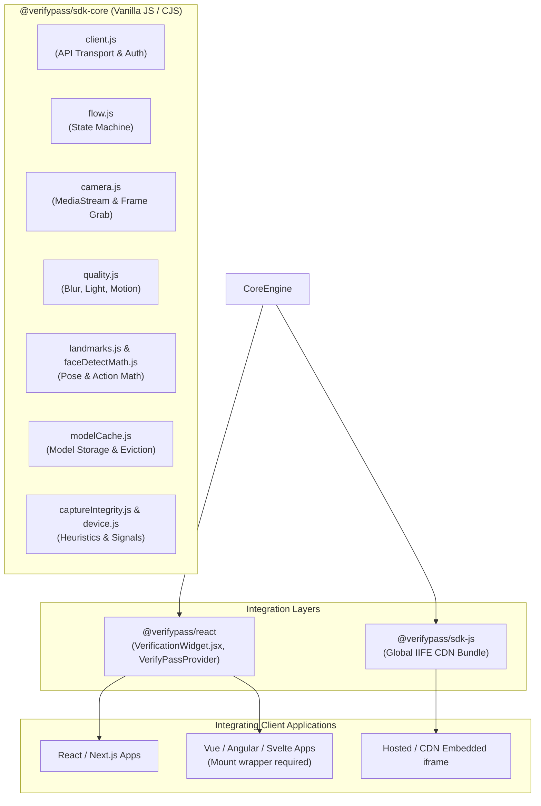
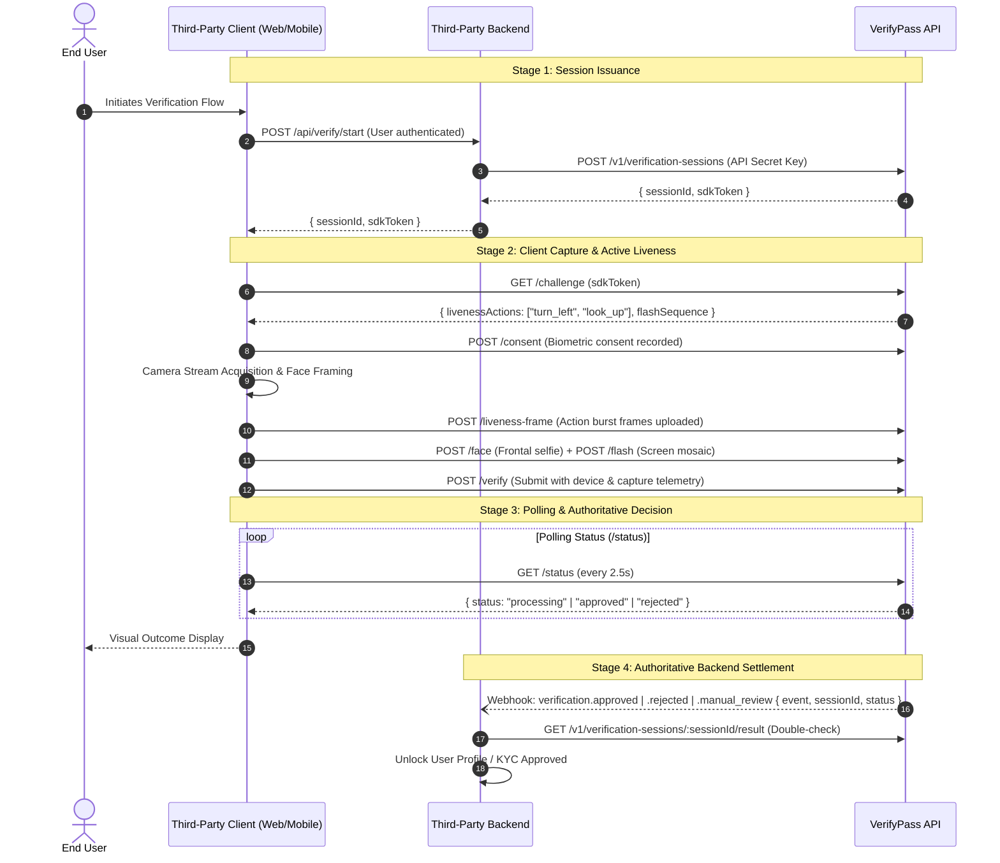

# VerifyPass Liveness Check SDK: Comprehensive Integration Analysis & Enhancement Blueprint

## 1. Executive Summary

This integration analysis evaluates the **VerifyPass Biometric Liveness Check SDK** (`@verifypass/sdk-core`, `@verifypass/react`, and `@verifypass/sdk-js`) from the perspective of **third-party developer adoption, integration simplicity, security, and developer experience (DX)**.

The current implementation provides a robust, security-conscious capture and verification engine with client-side ONNX-based head-pose estimation, screen-flash passive liveness, and mobile QR handoff. However, third-party adoption is currently hindered by:
1. **Framework coupling**: The primary full-feature interactive widget is tightly coupled to React (`@verifypass/react`), forcing non-React consumers (Vue, Angular, Svelte, vanilla web apps) to either mount a React root with heavy peer dependencies or settle for an `<iframe>` embed.
2. **Monolithic component architecture**: `VerificationWidget.jsx` is ~2,000 lines and tightly intertwines camera lifecycle, ONNX inference, UI rendering, coaching hints, and retry workflows, making white-labeling and UI customization difficult.
3. **Missing TypeScript definitions**: Neither `@verifypass/sdk-core` nor `@verifypass/react` ships with `.d.ts` types, forcing integrating teams to reverse-engineer and author ambient typings.
4. **Model asset management friction**: Integrators must manually copy and serve ~2.5 MB of ONNX model files and configure WASM MIME types and CSP headers.
5. **Lack of a Headless integration tier**: Advanced integrators cannot easily "bring their own UI" while leveraging the underlying capture and active liveness state machine.

This document provides a detailed structural breakdown of the existing SDK, maps the full end-to-end integration lifecycle, analyzes key friction points, and delivers an actionable enhancement roadmap to transform the SDK into an enterprise-ready, developer-friendly product.

---

## 1a. Implementation Status (2026-10-14)

Every item in this document has been implemented except npm publishing.

| Area | Status |
| :--- | :--- |
| Framework lock-in (§4.1) | **Done.** `<verifypass-liveness>` custom element (`@verifypass/sdk-js`): React, ONNX Runtime and the QR encoder are bundled (117 KB gzip); zero runtime dependencies. CDN: `/sdk/v1/verifypass-liveness.js` on the hosted origin. |
| Monolith (§4.2) | **Done.** Session logic lives in a headless controller (`sdk-core/src/controller.js`). Auto-capture is in `react/src/captureLoop.js`, the React binding in `useVerification`, and the UI is split into `ConsentGate`, `CaptureView`, `MobileHandoffView`, `OutcomeView`, `ActionArrow` and `Spinner`. |
| TypeScript (§4.3) | **Done.** `.d.ts` files for core, react and js. The sdk-js types are self-contained. |
| Model/WASM burden (§4.4) | **Done.** Models and the ORT WASM are served by the hosted origin (CORS, cached, SHA-256 verified). Integrators copy nothing. Explicit URLs still override. |
| Hardcoded test defaults (§4.5) | **Done.** No SDK fallback to `LIVE_TEST_*`; the constants remain only as deprecated exports for the sample apps. |
| Error taxonomy | **Done.** `VerifyPassError` with stable codes on every `onError` / `vp-error`. |
| Theming / white-label | **Done.** `--vp-*` CSS custom properties plus the `theme` prop; all text overridable via `copy`. |
| Headless tier | **Done.** `createVerificationController` (any framework) and `useVerification` (React). |
| Playground | **Done.** `/sdk/v1/playground.html` on the hosted origin. Playwright covers the element, theming, copy, the provider-less widget and controller-driven capture with a synthetic camera. |
| CORS blocker (not in the original analysis) | **Done.** The API allowed only `CORS_ORIGINS`, which forced integrators to build a server relay. Browser SDK routes now accept any origin; secret-key and dashboard routes stay allowlisted. |
| npm publishing | Not done (out of scope). Packages install from git with a committed `dist/`. |

## 2. Architecture & Component Decomposition

The SDK is organized as a monorepo-style suite of three packages:



### Component Breakdown & Roles

| Package / Module | Responsibility | Current Implementation State |
| :--- | :--- | :--- |
| **`@verifypass/sdk-core`** | Framework-agnostic capture engine, camera management, frame quality scoring, mathematical pose estimation, signal integrity, and API transport. | Robust logic in CommonJS. Self-contained math. No TypeScript definitions. |
| **`@verifypass/react`** | React context provider (`VerifyPassProvider`) and all-in-one widget (`VerificationWidget`). Runs browser-side ONNX Runtime Web inference (`fr_detect.onnx`, `fr_landmark.onnx`). | Feature-rich (~2,000 lines single file), but monolithic and React-exclusive. |
| **`@verifypass/sdk-js`** | Vanilla CDN bundle (`VerifyPass.init`). | Bundles esbuild IIFE. Embeds hosted iframe for desktop capture; renders QR code for mobile handoff. Does not run client-side ONNX. |
| **Host Integration** (`LivenessSdkMount.vue`) | Vue 3 host component mounting the React SDK via `createRoot` and `createElement`. | Demonstrates real-world overhead for non-React consumers. |

---

## 3. End-to-End Integration Journey for Third Parties

A typical third-party developer integration follows a three-stage lifecycle: Backend Session Setup, Client Capture, and Backend Verification Confirmation.



### Key Architectural Strengths
1. **Server-Authoritative Decisions**: The client-side SDK is strictly an input capture and advisory agent. All fraud decisions, face comparisons, and active liveness validations occur on the server.
2. **Zero Secret Exposure**: Only the short-lived `sdkToken` and `sessionId` are exposed to the browser.
3. **Self-Locating Tokens**: The `sdk_v1_...` token embeds the target API base URL in base64url, eliminating environment configuration mistakes for consumers.
4. **Resilient Polling**: `waitForResult` handles intermittent mobile network failures and server 5xx hiccups without breaking the user session.
5. **Mobile QR Handoff**: Desktop users can seamlessly transition to mobile using a single-use fragment-bearer link (`#h=...`).

---

## 4. In-Depth Integration Friction Analysis

While the underlying biometric and transport engine is solid, several barriers currently make third-party integration cumbersome:

### 4.1 Framework Lock-in & Cross-Framework Friction
* **The Problem**: Over 60% of enterprise web applications do not use React (they use Vue, Angular, Svelte, or server-rendered frameworks like Laravel/Django/Rails with Alpine or vanilla JS).
* **Current Impact**: Non-React developers have only two suboptimal choices:
  1. Pull in `@verifypass/react` along with `react` and `react-dom` as external dependencies, and manually bridge lifecycles via `createRoot` and `unmount` (as demonstrated in `src/components/onboarding/LivenessSdkMount.vue`). This adds ~140 KB of dead weight to their bundle and introduces complex event bridge plumbing.
  2. Use `@verifypass/sdk-js`, which falls back to an `<iframe>` loading the hosted page. Iframes create significant issues with:
     * Camera permissions delegation (`allow="camera"` and Permissions-Policy).
     * Content Security Policy (CSP) headers across domains.
     * Inability to match host application design, theming, or typography.
     * Cross-origin cookie/session edge cases in privacy-focused browsers (Safari ITP, Brave).

### 4.2 Monolithic Architecture in `VerificationWidget.jsx`
* **The Problem**: At ~2,000 lines of code, `VerificationWidget.jsx` is an all-in-one monolith. It embeds:
  * Consent modal and version tracking.
  * Camera initialization, permission error prompts, and track cleanup.
  * Real-time Canvas drawing, guide overlays, and directional arrows.
  * Active liveness action scheduler, burst frame capturer, and framing stabilizer.
  * Screen flash color sequencer.
  * Document capture (front and back) and shape analysis.
  * Mobile handoff QR generator and status poller.
  * Hardcoded localized copy and inline SVG icons.
* **Current Impact**: Third parties cannot replace or customize individual parts. For instance, if an enterprise customer wants to provide their own custom camera oval or step headers, they cannot do so without forking the entire widget.

### 4.3 Missing TypeScript Declarations
* **The Problem**: Neither `@verifypass/sdk-core` nor `@verifypass/react` contains `.d.ts` declaration files.
* **Current Impact**: Integrating engineers in modern TypeScript projects get `Cannot find module '@verifypass/react'` or are forced to create local `declare module "@verifypass/react"` shims (as was done in `src/types/liveness-check.d.ts`). This slows down onboarding and leads to type drift and missed updates.

### 4.4 Model Hosting & WASM Operational Burden
* **The Problem**: The React widget requires two ONNX models (`fr_detect.onnx` ~1.2 MB, `fr_landmark.onnx` ~1.1 MB) and `onnxruntime-web` WASM binaries (~14 MB uncompressed).
* **Current Impact**:
  * Third parties must remember to manually copy these model files into their public distribution directory (`/public/models/`).
  * If a hosting server lacks correct MIME type configuration for `.wasm` (`application/wasm`) or `.onnx` (`application/octet-stream`), the SDK fails or falls back silently.
  * Content Security Policy (CSP) must explicitly permit `wasm-unsafe-eval` (or `'unsafe-eval'`), which many enterprise security teams flag during review.

### 4.5 Hardcoded Test Defaults in Production Artifacts
* **The Problem**: In `VerifyPassProvider.jsx`:
  ```javascript
  export const LIVE_TEST_API_BASE = "https://uybb6wv27prwyijtkcteovvvke0hfkqw.lambda-url.us-east-2.on.aws";
  export const LIVE_TEST_PUBLIC_KEY = "vp_pub_test_g0CAzW80fTNG5GJYV2wA1XUFFXov7VU9";
  ```
* **Current Impact**: `LIVE_TEST_API_BASE` is exported but is **not** used as a fallback: the API origin always comes from the self-locating token or explicit configuration, so requests cannot silently reach the Lambda. `LIVE_TEST_PUBLIC_KEY` **is** a fallback (`publicKey` defaults to it when `VITE_VP_PUBLIC_KEY` is unset), so a misconfigured app sends the test public key to whatever API its token points at. This is a configuration-hygiene issue (P1) rather than a data-leakage hazard.

---

## 5. Comparative Developer Experience (DX) Assessment

| Feature | Current VerifyPass SDK | Target Enhanced SDK | Industry Benchmark (Stripe, Onfido, Persona) |
| :--- | :--- | :--- | :--- |
| **Framework Support** | React widget or Vanilla iframe fallback | First-class React, Vue, Angular, & Custom Element (Web Component) | Framework-agnostic Web Component + React/Vue wrappers |
| **TypeScript Support** | None (requires ambient `.d.ts` shims) | Strict TypeScript source + bundled `.d.ts` definitions | Complete `.d.ts` with strict Discriminated Unions |
| **UI Customization** | Minimal (`primaryColor`, `logoUrl`) | Multi-tier: Drop-in UI, Themed Web Component, or Headless Hook | Theming tokens (CSS variables) + Headless API |
| **Model Distribution** | Manual copying to local `/public` folder | Built-in CDN fallback + local asset override | CDN-hosted model assets with integrity hashes |
| **Bundle Footprint** | ~140 KB React deps + ~14 MB WASM | Lightweight core (<30 KB) + on-demand WASM streaming | Lazy chunking with preflight capability checks |
| **Error Taxonomy** | Generic Error instances & API error codes | Strongly typed `VerifyPassError` enum with remediation guides | Categorized errors (`CAMERA_DENIED`, `FACE_LOST`, etc.) |

---

## 6. Actionable Enhancement Blueprint & Implementation Roadmap

To make the VerifyPass Liveness Check SDK simple, reliable, and delightful for any third-party developer, the following phased enhancements are recommended:

### Phase 1: DX Foundation & Hygiene (Immediate / Quick Wins)

1. **Ship Bundled TypeScript Declarations** *(done: `frontend/sdk/{core,react,js}/index.d.ts`)*:
   Types follow the real API. Key shapes:
   ```typescript
   // GET /status response; decision/liveness only on terminal statuses
   export interface VerificationResult {
     success: true;
     sessionId: string;
     status: "created" | "started" | "submitted" | "approved" | "rejected" | "manual_review" | "expired" | "failed" | "abandoned";
     attemptId: string | null;
     decision?: { status: TerminalStatus; reasonCodes: string[] };   // user-actionable codes only
     liveness?: { score: number | null; selfieScore: number | null };
   }

   export interface VerificationWidgetProps {
     sessionId: string;
     sdkToken: string;
     theme?: { primaryColor?: string; logoUrl?: string };
     consentCopy?: string;
     screenFlash?: boolean;                 // default true
     mobileHandoff?: boolean;               // true = QR only, false = this device, undefined = user chooses
     onComplete?: (result: VerificationResult) => void;
     onError?: (error: VerifyPassError) => void;
     onStepChange?: (step: FlowStep) => void;
     onTelemetry?: (event: { type: string; [key: string]: unknown }) => void;
   }
   ```

2. **Purge Hardcoded AWS Lambda / Test Credentials**:
   Remove `LIVE_TEST_API_BASE` and `LIVE_TEST_PUBLIC_KEY` from default prop fallbacks. Force explicit configuration or valid self-locating tokens, failing fast with descriptive developer errors.

3. **Standardize Error Taxonomy** *(done: every `onError` now receives a `VerifyPassError` with a stable `code` and the original error as `cause`; API errors keep their server code)*:
   ```typescript
   export type VerifyPassErrorCode =
     | "CAMERA_PERMISSION_DENIED" | "CAMERA_NOT_FOUND" | "CAMERA_IN_USE" | "CAMERA_UNSUPPORTED" | "CAMERA_ERROR"
     | "NETWORK_ERROR" | "REQUEST_TIMEOUT" | "POLLING_TIMEOUT" | "INVALID_RESPONSE"
     | "INIT_FAILED" | "UNSUPPORTED_WORKFLOW" | "CAPTURE_FAILED" | "UNKNOWN_ERROR"
     | (string & {}); // server codes: SESSION_EXPIRED, SESSION_NOT_FOUND, INVALID_API_KEY, ...
   ```

---

### Phase 2: Decoupled Headless Engine & Web Component (Medium-Term)

1. **Extract Headless Controller (`LivenessSessionController`)**:
   Refactor `VerificationWidget.jsx` by extracting all state transitions, camera management, action triggers, and frame uploads into a framework-free controller in `@verifypass/sdk-core`:
   ```typescript
   import { LivenessController } from "@verifypass/sdk-core";

   const session = new LivenessController({
     sessionId,
     sdkToken,
     onActionPrompt: (action) => updateUI(`Please ${action}`),
     onFrameAccepted: (count) => updateProgressBar(count),
     onComplete: (result) => handleSuccess(result)
   });

   await session.start();
   ```

2. **Provide Universal Web Component (`<verifypass-liveness>`)**:
   Package a standard Custom Element via Lit or vanilla Web Components. This enables one-line integration across **React, Vue, Angular, Svelte, or plain HTML**:
   ```html
   <!-- Vanilla HTML / Vue / Angular / React all use the same tag -->
   <verifypass-liveness
     session-id="vps_12345"
     sdk-token="sdk_v1_xyz..."
     theme-color="#2cd2bf"
     id="liveness-widget">
   </verifypass-liveness>

   <script>
     const el = document.getElementById("liveness-widget");
     el.addEventListener("vp-complete", (e) => console.log(e.detail));
     el.addEventListener("vp-error", (e) => console.error(e.detail));
   </script>
   ```

3. **Decompose React Component Hierarchy**:
   Split `VerificationWidget.jsx` into clean, testable subcomponents:
   * `<LivenessCameraPreview>`
   * `<ActionOverlayGuide>`
   * `<ScreenFlashSequencer>`
   * `<MobileHandoffQR>`
   * `<ConsentGate>`
   * `<OutcomeBanner>`

---

### Phase 3: Zero-Friction Asset Delivery & Advanced Capabilities (Long-Term)

1. **Managed Global CDN for ONNX & WASM**:
   Provide a zero-config default where models and WASM assets are served from a high-speed, globally distributed CDN with Subresource Integrity (SRI) hashes:
   ```javascript
   // Default loads from cdn.verifypass.com/models/v1/...
   // Integrator can still override with local paths if air-gapped:
   <VerificationWidget
     modelBaseUrl="https://cdn.verifypass.com/models/v1.2"
   />
   ```
2. **Headless React Hook (`useLiveness`)**:
   For advanced enterprise teams wanting 100% custom UI designs:
   ```jsx
   const {
     videoRef,
     currentAction,
     framingStatus,
     startCamera,
     captureSelfie,
     isAnalyzing
   } = useLiveness({ sessionId, sdkToken });
   ```
3. **Interactive Developer Documentation & Playground**:
   * Host an interactive sandbox (CodeSandbox / StackBlitz) with copy-paste snippets for Next.js, Vue 3 (Vite), Angular, and Vanilla JS.
   * Provide a synthetic camera test harness so developers can test liveness flows in CI/CD without physical hardware.

---

## 7. Recommended Integration Reference Guide for Third Parties

Below is the standard integration pattern to publish in developer documentation:

There is no server SDK package; call the REST API with the tenant **secret** key from your backend.

### Step 1: Backend Session Creation (Node.js Example)
```javascript
app.post("/api/start-liveness", requireUser, async (req, res) => {
  const r = await fetch(`${process.env.VP_API_BASE}/v1/verification-sessions`, {
    method: "POST",
    headers: { Authorization: `Bearer ${process.env.VP_SECRET_KEY}`, "Content-Type": "application/json" },
    body: JSON.stringify({
      verificationType: "FACE_ONLY",            // or "ID_AND_FACE" (default) / "ID_ONLY"
      customerReference: req.user.id,
      callbackUrl: "https://api.merchant.com/webhooks/verifypass"
    })
  });
  const session = await r.json();               // 201 { sessionId, sdkToken, hostedUrl, expiresAt, ... }

  // Return only the session ID and short-lived SDK token to the browser
  res.json({ sessionId: session.sessionId, sdkToken: session.sdkToken });
});
```

### Step 2: Frontend Integration
React (any bundler; the package ships prebuilt ESM):
```jsx
import { VerifyPassProvider, VerificationWidget } from "@verifypass/react";
// Vite:            import ortWasmUrl from "onnxruntime-web/ort-wasm-simd-threaded.wasm?url";
// webpack/Next.js: const ortWasmUrl = new URL("onnxruntime-web/ort-wasm-simd-threaded.wasm", import.meta.url).href;

<VerifyPassProvider ortWasmUrl={ortWasmUrl} faceModelUrl="/models/fr_detect.onnx">
  <VerificationWidget
    sessionId={sessionId}
    sdkToken={sdkToken}
    onComplete={() => confirmOnBackend(sessionId)}   // UI hint only
    onError={(e) => e.code === "CAMERA_PERMISSION_DENIED" && showCameraHelp()}
  />
</VerifyPassProvider>
```

Vanilla JS / any framework (CDN bundle, hosted iframe or QR handoff):
```html
<script src="https://<your-cdn>/verifypass.js"></script>
<div id="liveness"></div>
<script>
  const instance = VerifyPass.init({
    container: "#liveness",
    sessionId: "vps_abc123",
    sdkToken: "sdk_v1_...",
    onComplete: () => fetch("/api/liveness/confirm"),
    onError: (e) => console.error(e.code, e.message)
  });
  // instance.destroy() on teardown
</script>
```

The `<verifypass-liveness>` Web Component in §6 Phase 2 is **planned**, not shipped.

### Step 3: Webhook Verification on Backend
Webhooks are signed with HMAC-SHA256 over `${timestamp}.${rawBody}`. Headers: `X-Verifypass-Signature: sha256=<hex>`, `X-Verifypass-Timestamp`, `X-Verifypass-Event`. Reject timestamps older than 5 minutes.
```javascript
const crypto = require("crypto");

app.post("/webhooks/verifypass", express.raw({ type: "application/json" }), async (req, res) => {
  const ts = Number(req.get("x-verifypass-timestamp"));
  const sig = req.get("x-verifypass-signature") || "";
  const expected = "sha256=" + crypto.createHmac("sha256", process.env.VP_WEBHOOK_SECRET)
    .update(`${ts}.${req.body}`).digest("hex");
  const fresh = ts && Math.abs(Date.now() / 1000 - ts) <= 300;
  if (!fresh || sig.length !== expected.length || !crypto.timingSafeEqual(Buffer.from(sig), Buffer.from(expected))) {
    return res.sendStatus(401);
  }

  const event = JSON.parse(req.body);           // { event, sessionId, status, createdAt, ... }
  if (event.event === "verification.approved") {
    // Optional: re-fetch GET /v1/verification-sessions/:sessionId/result with the secret key
    await db.users.markKycPassed(event.sessionId);
  }
  res.sendStatus(200);
});
```
Events: `verification.created`, `.started`, `.submitted`, `.approved`, `.rejected`, `.manual_review`, `.expired`, `.failed`.

---

## 8. Summary Table of Actionable Recommendations

| Priority | Initiative | Target Beneficiary | Impact | Effort |
| :---: | :--- | :--- | :--- | :---: |
| **P0** | Export official TypeScript `.d.ts` types | All third-party engineers | Eliminates type guessing; instant IDE autocomplete | Low (1-2 days) |
| **P0** | Remove hardcoded test AWS endpoints/keys | Security & Compliance | Prevents accidental telemetry & credential leakage | Low (1 day) |
| **P1** | Build Web Component wrapper (`<verifypass-liveness>`) | Vue, Angular, Svelte, & Vanilla teams | Removes React runtime requirement for non-React apps | Medium (3-5 days) |
| **P1** | Modularize `VerificationWidget.jsx` into subcomponents | React developers & Designers | Enables custom styling, white-labeling, and modular maintenance | Medium (1 week) |
| **P2** | Extract Headless `LivenessController` into `sdk-core` | Advanced enterprise integrators | Enables 100% custom UI implementations | Medium (1 week) |
| **P2** | Host model assets & WASM on global CDN with SRI | DevOps & Frontend integrators | Eliminates manual file copying and WASM MIME issues | Medium (3-4 days) |
| **P3** | Interactive Sandbox & Mock Testing CLI | New prospective customers | Drastically shortens time-to-first-integration (TTFI) | Medium (1 week) |
